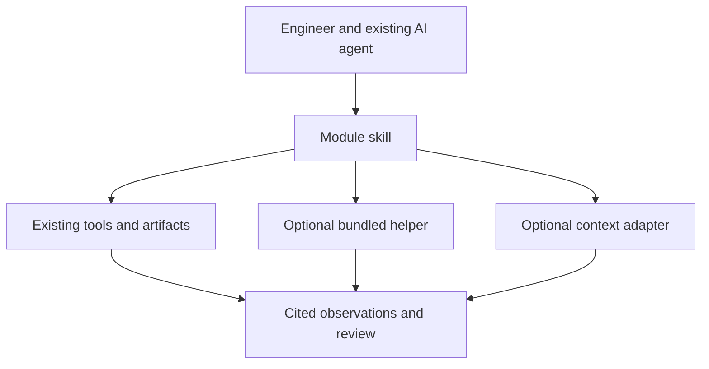

# Architecture

OpenTools runs through the engineer's existing file/tool-enabled AI agent. The
agent selects evidence and methods; bundled Python helpers provide repeatable
checks for supported input profiles. No model-provider SDK is required.

## Module package

Each `modules/<id>/module.json` declares its `SKILL.md`, distributable files,
engineering stages and optional helpers. Discovery reads manifests rather than
a fixed module list. A module can provide a workflow with no executable helper.

The AI can use existing tools or develop a separately validated method beyond a
helper's profile. Preserve machine findings and distinguish source observations,
interpretation, proposals and accepted policy. A hash or valid record does not
establish source truth or engineering sufficiency.

## Host integration

The Python 3.10+ standard-library [installer](INSTALL.md) exports a self-contained
package into the selected project. It changes no global agent settings and installs
no native dependencies, models or DVIT software. Skills can also be read from a clone.

Host options select discovery paths: `.agents/skills` for Codex, `.claude/skills`
for Claude Code and `.opentools/skills` for generic export. Filesystem/execution
access and model data handling belong to the host. Native EDA adapters retain their
own version, operating-system and target requirements.

## Context adapters

The optional [context protocol](CONTEXT_PORT.md) supports capability discovery,
scoped evidence, questions, seeds and helper descriptions. File exchange and an
explicitly enabled stdio adapter use the same OpenTools envelope. Sources may be
company systems or a separately installed matching DVIT adapter.

The caller chooses the source and exact scope. Missing context does not block
standalone use or select another source. OpenTools validates protocol structure
and binding; source authentication, authorization and evidence verification belong
to the adapter/source. The protocol does not assume an unreleased DVIT endpoint.

References: [Codex skills](https://learn.chatgpt.com/docs/build-skills),
[Claude Code skills](https://code.claude.com/docs/en/skills),
[Agent Skills specification](https://agentskills.io/specification).
